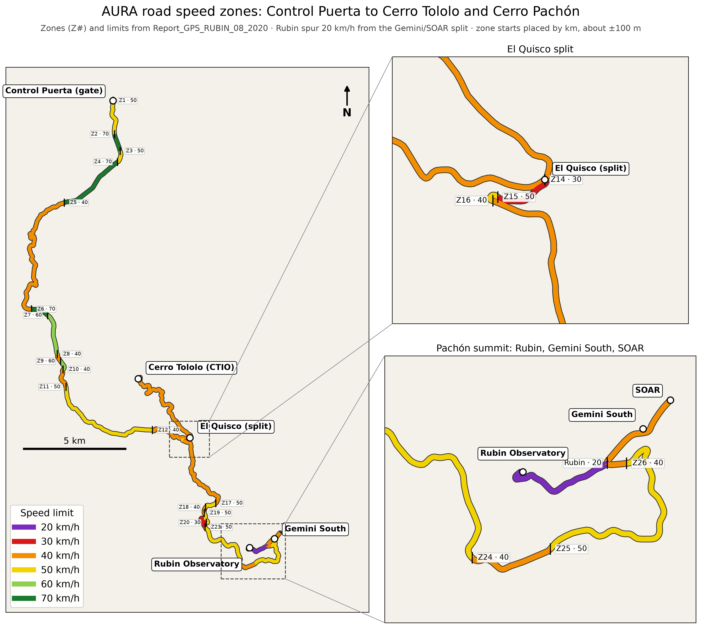

# Mountain Roads

Speed awareness for drivers on the AURA road from the gate (Control Puerta
AURA) to Cerro Tololo and Cerro Pachón.

- "Your Speed" and "Speed Limit" side by side (stacked in portrait). Off the
  mountain roads the limit shows X, with the distance to the nearest road.
- Background: solid green when fine; tiled yellow yield triangles plus a soft
  beep when more than 10% over; tiled red stop octagons plus a loud long beep
  when more than 20% over. About 5 s of silence between beeps.
- Android: always running. A background service starts at boot, keeps going
  when the app is closed or swiped away, and sleeps (coarse location every
  20 s, GPS off) when more than 1 km from the mountain roads. iOS tracks in
  the background but stops when the app is swiped away.
- Gear button (bottom right): permission status (green/red) and the optional
  SD card access.

### Settings folder (Android, optional)

With SD card access allowed, the app creates `/sdcard/MountainRoads` with a
`ReadMe.txt` and reads it at startup (or via Settings → Reload):

| File | Effect |
|---|---|
| `1.mp3` / `2.mp3` | Yellow and red alarm sounds; replace with your own (`.wav`, `.m4a`, `.ogg` also work). Written with the built-in beeps if missing. |
| `0SecondsWarning.txt` | Beep immediately. Rename to `10SecondsWarning.txt` / `20SecondsWarning.txt` to beep only after 10 / 20 s over the limit (the screen still changes at once). |
| `ruta41_off.txt` | Alarm starts at Control Puerta (written by default). Rename to `ruta41_on.txt` (or `ruta41.txt`) to start at La Serena airport and cover Ruta 41 (zones A–M). |
| `1020percent.txt` | Alarms over 10% / 20% of the limit (default). Rename to e.g. `1530percent.txt` or `0510percent.txt`; without `percent` (`1020.txt`, `0510.txt`, `0515.txt`) the digits are km/h over the limit. First two digits yellow, last two red. |
| `60_up.txt`, `40_down.txt`, … | Speed signs recorded in debug mode, one `lat,lon` line each. From a sign on, in its direction (up or down the mountain), its limit replaces the built-in one until the next zone change or sign. |
| `SpeedZones.png`, `SpeedZones_Ruta41.png` | The two speed-limit maps (rewritten by the app at each start). |
| `ColorBlind.txt` | First line `color1,color2,color3` (hex) replaces green / yellow / red. An empty file gets the Okabe–Ito colour-blind-safe set `#0072B2,#F0E442,#D55E00`. |

Settings also has a **Random alarm** checkbox (off by default, stored in the app): each alarm then picks a sound at random: yellow from the beep (or `1.mp3`), `mein-leben` and `fallout-sirene`; red from the loud beep (or `2.mp3`), `r2d2_scream_converted`, `red-siren-alert` and `firebat-slow-down` (all in `assets/sounds/random/`). Alarm 1 peaks at 60% of full scale.

**Debug mode** (Settings, off by default) replaces the speed limit panel with a 3×4 grid: the current limit, ↑ / ↓ for the driving direction (↑ when debug mode is switched on), and buttons 20–100. Tapping a number appends the current position to e.g. `60_up.txt`, which is used at once. The driving direction for limits is detected from movement along the road.

## Privacy

This application is developed solely to assist the driver in maintaining
proper speed. This application will never send data to the internet and
never record, transmit or share any information with anyone.

The required permissions (location all the time, notifications, unrestricted
battery) are used so your phone can stay in your pocket and still alarm you if
you are going too fast. When you are not on the Mountain Roads the app is in a
sleep-like mode: GPS off, rough position checked only every 20 seconds.

The Android app does not request the `INTERNET` permission, so it cannot
connect to the internet. Position and speed are kept in memory only, never
written to storage. The only files it writes are the settings files in
`/sdcard/MountainRoads`, and only if you allow SD card access.

## Speed-limit data



With `ruta41.txt`: [docs/speed_zones_ruta41.png](docs/speed_zones_ruta41.png)
(`.venv/bin/python tools/render_map.py --ruta41`).

Ruta 41 uses the 2020 report's zones A–M. The report gives only place
names for them, so their positions were taken from the report's geofence map
(georeferenced onto the road). OpenStreetMap `maxspeed` was tried and dropped:
it is wrong for most of the route.

Zones come from the 2020 AURA report `Report_GPS_RUBIN_08_2020_Kevin.xlsx` (not in this repository; sheet "Zone
locations": km from Control Puerta and max speed), copied into
`tools/data/zones.csv`:

- Zones 1–13: gate to El Quisco (the split), shared by all branches.
- Zone 27: El Quisco to Tololo, 40 km/h.
- Zones 14–26: El Quisco to Gemini South and on to SOAR on Cerro Pachón.
- Rubin spur: from where the road to Rubin Observatory splits from the
  Gemini/SOAR road just after zone 26, 20 km/h (not in the 2020 report).
  Its geometry is OpenStreetMap way 136183611 (`tools/data/rubin_access_road.json`);
  routers skip it as private and use the old, closed road instead.

Report km are scaled (×0.98) so El Quisco lands where it is on the mapped
road, which places zone starts to roughly ±100 m. Near each change the lower
limit is used for 100 m either side, so very short zones (13, 21) are
absorbed by the slower neighbour. Zones placed by `lat,lon` (the El Quisco
and Rubin splits, sign photos) are exact and not moved, so a branch's limit
never spills back onto the shared road.

A zone row can give `lat,lon` instead of `start_km` for an exact position,
e.g. from a sign photo (`tools/photos_to_csv.py` reads photo GPS). After
editing:

```bash
python3 tools/build_road_data.py
.venv/bin/python tools/render_map.py     # docs/speed_zones.png (needs matplotlib)
```

## Build

```bash
flutter test
flutter build apk --release      # Android: build/app/outputs/flutter-apk/app-release.apk
flutter run                      # on a connected phone
```

iOS needs full Xcode (App Store), then `sudo xcode-select --switch
/Applications/Xcode.app/Contents/Developer`, open `ios/Runner.xcworkspace`,
set your Team under Signing, and `flutter run` with the iPhone connected.
